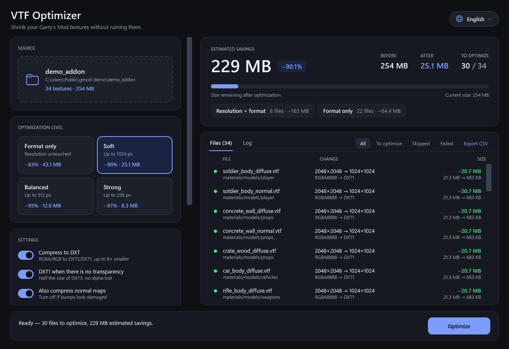
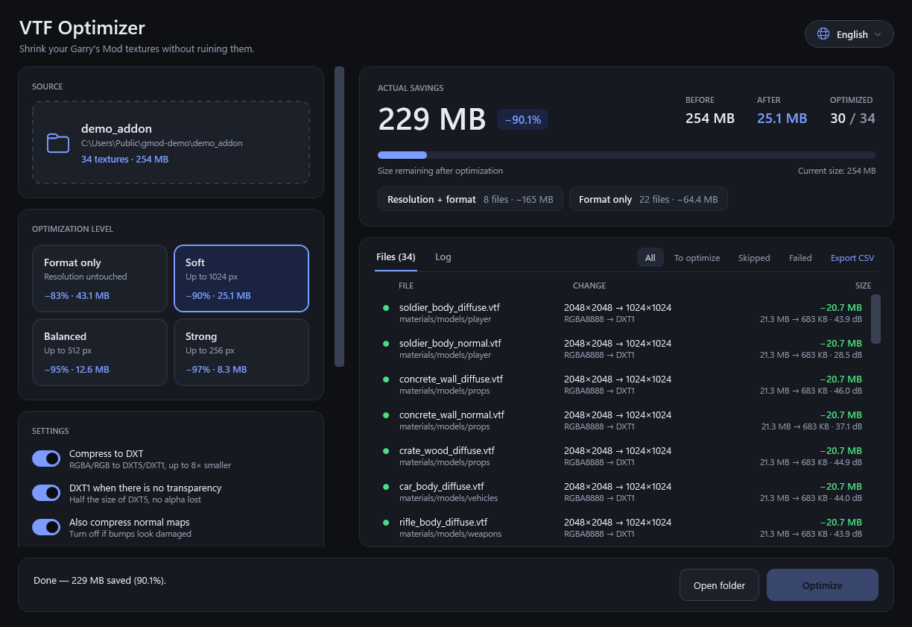
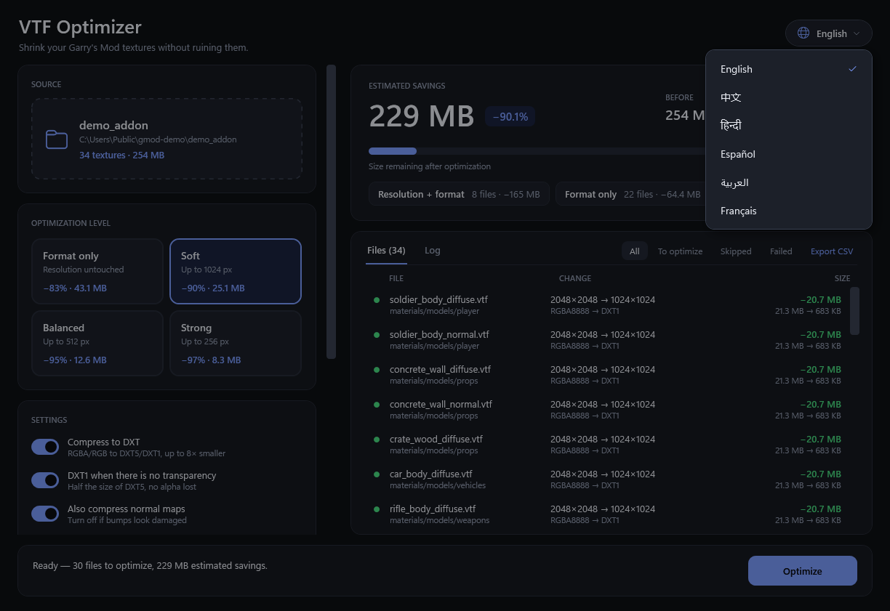
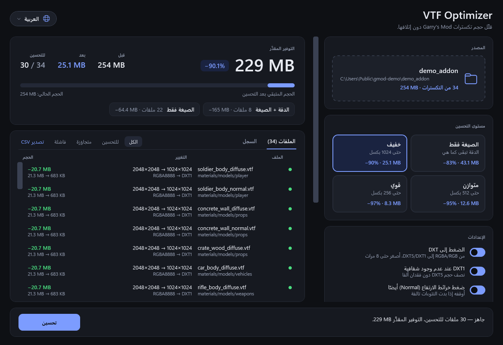
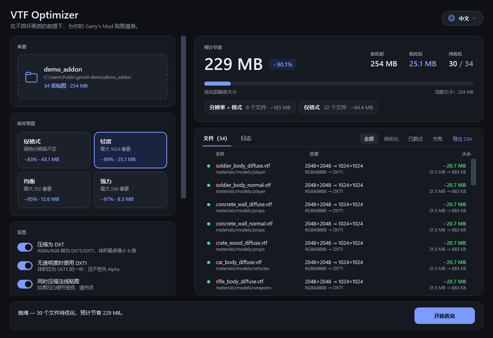

# VTF Optimizer

**Make your Garry's Mod textures way smaller. Drop a folder, pick a level, done.**



- 📉 Up to **~90% smaller** `.vtf` files (real addon pack: 326 MB → 76 MB)
- 👀 Shows the exact savings **before** it touches anything
- 🛡️ Your originals stay safe, it writes to a copy by default
- ⚡ Takes seconds, no PNG mess left behind
- 🌍 English, 中文, हिन्दी, Español, العربية, Français

## Get it

1. Install the [.NET 7 Desktop Runtime (x64)](https://dotnet.microsoft.com/en-us/download/dotnet/7.0) if you don't have it
2. Download the zip from [Releases](../../releases) and extract it
3. Run `VtfOptimizer.exe`

## Use it

1. Drop your addon folder on the window
2. Pick a level, each card shows the savings for *your* files
3. Hit **Optimize**, the result goes to a new folder
4. Test it in-game, then swap it in

| Level | What it does |
|---|---|
| **Format only** | Keeps resolutions, just compresses |
| **Soft** | Max 1024 px |
| **Balanced** | Max 512 px |
| **Strong** | Max 256 px |

## Good to know

- **Beta.** Tested on thousands of textures, but check the result in-game before replacing your original content.
- It only touches `.vtf` files. Workshop `.gma` addons: extract them first with `gmad.exe`.
- A quality guard skips any texture that would end up looking bad.

## Command line

```bash
vtfopt optimize "path/to/addon" --max 1024                    # preview, writes nothing
vtfopt optimize "path/to/addon" --apply --out "path/to/out"   # do it
```

`vtfopt help` lists everything.

<details>
<summary>More screenshots</summary>

 
 

</details>

## Build it yourself

```bash
dotnet build src/ContentOptimizer.sln -c Release
```

Needs the [.NET 7 SDK](https://dotnet.microsoft.com/en-us/download/dotnet/7.0). The GUI is Windows only.

Translations were machine-assisted, fixes are welcome. To add a language, copy `src/ContentOptimizer.App/Languages/En.cs` and register it in `Services/Loc.cs`.

## License

[AGPL-3.0](LICENSE) © 2026 sogekiDEV
